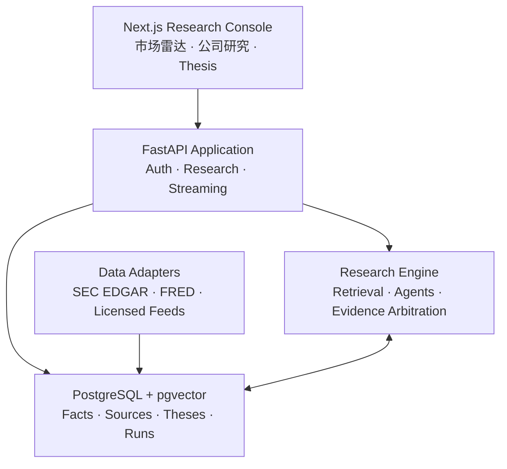

# NEXUS ALPHA

### Evidence-first AI Investment Intelligence OS

> **From information to intelligence. From intelligence to conviction.**

一个面向中文用户的 AI 原生金融研究工作台：从原始信息、结构化证据到多角度研究，再到可持续验证的投资假设。

**当前状态：Phase 0 / 技术验证（PoC）。** 本仓库已经提供 SEC EDGAR 财务数据获取与标准化脚本、测试、技术设计，以及**可在本地直接打开的交互式金融终端静态预览**；**尚未实现** Next.js 完整 Web 产品、数据库、AI Agent 和自动监控，也未声称通过真实网络完成在线测试。

## Interface Preview / 界面预览

直接在浏览器打开 [`preview/index.html`](preview/index.html)，无需安装依赖或启动服务器。

- 默认展示清楚标注为 **SYNTHETIC DEMO DATA** 的虚构公司，仅用于体验界面。
- 点击 **Import SEC snapshot**，选择数据脚本生成的 `output/nvda.json`，即可在界面中查看真正的 SEC 财务指标及申报证据。
- 支持数据覆盖率展示、原始来源链接、JSON 导出和**仅保存在本浏览器中**的研究笔记。
- Agent、Thesis 与 Knowledge Graph 是路线图，不会被伪装为已经运行的功能。

## 为什么要做

传统投研工作常常被割裂成行情、公告、财报、搜索、笔记和聊天等独立工具。NEXUS ALPHA 的目标是将它们组织为同一个研究闭环：

**发现变化 → 检索原始证据 → 形成可证伪假设 → 交叉验证 → 持续跟踪 → 复盘。**

区别于普通的“AI 股票摘要”，我们强调三项长期能力：

1. **Evidence Ledger（证据账本）**：重要结论必须指向原始来源、披露日期和具体指标。
2. **Research Adjudication（研究裁决）**：多空分歧转化成可检验变量、估值敏感性和反证条件，而不是 Agent 投票。
3. **Living Thesis（动态投资假设）**：研究观点像代码一样有版本、差异、审查记录和失效条件。

## 架构总览

> 下图是目标架构，**虚线以外的各模块不代表当前已经落地**；当前实际落地的是 SEC 适配器与财务指标快照生成。



详细设计见 [docs/architecture.md](docs/architecture.md)，多 Agent 观点裁决见 [docs/research-adjudication.md](docs/research-adjudication.md)。

## 现在能运行什么

第一个可运行切片：**输入 NVDA → 获取官方 ticker/CIK 映射 → 拉取 SEC Company Facts → 提取可溯源的财务指标 → 输出机器可读 JSON。**

- 数据源：SEC EDGAR（官方公开披露数据）
- 编程语言：Python 3.11+，仅使用标准库
- 输入：股票代码，或可选的 as-of 截止日期
- 输出：带会计标签、单位、财期、申报日期、申报编号及来源 URL 的 JSON
- 测试：离线单元测试，无 API Key 或互联网也能运行

### 1. 安装

```bash
# 进入本仓库（或下载的 ZIP 解压目录）
cd nexus-alpha
python -m pip install -e .
```

**注意：** 仓库若尚未发布到 GitHub，直接从 ZIP 解压后进入项目目录即可。

### 2. 配置 SEC 身份标识

SEC 对自动化访问要求提供可识别的 User-Agent。请使用你真实的姓名或机构名称及可联系邮箱：

```bash
export SEC_USER_AGENT="NexusAlpha Research your-real-email@example.com"
```

请替换为真实联系方式，不能直接使用示例邮箱。Windows PowerShell 使用：

```powershell
$env:SEC_USER_AGENT = "NexusAlpha Research your-real-email@example.com"
```

### 3. 获取 NVIDIA 的财务事实

```bash
nexus-alpha fetch NVDA --output output/nvda.json
```

也可以指定财务信息披露截止日，避免在历史研究中混入未来披露的数据：

```bash
nexus-alpha fetch NVDA --as-of 2025-01-31 --output output/nvda-2025-01-31.json
```

示意输出结构（以下**不包含真实财务数字**）：

```json
{
  "ticker": "NVDA",
  "cik": "0001045810",
  "source": {"provider": "SEC EDGAR", "kind": "companyfacts"},
  "metrics": {
    "revenue": {
      "value": "<来自 SEC 的实际值>",
      "unit": "USD",
      "period_start": "<日期>",
      "period_end": "<日期>",
      "filed": "<日期>",
      "accession": "<SEC 申报编号>",
      "concept": "<US-GAAP 标签>"
    }
  }
}
```

所有实测值只能由真实 API 返回，程序不会填充假数据。若数据不可用，会返回错误或将缺失指标标记为 `null`，不会自行编造。

### 4. 运行测试

```bash
python -m unittest discover -s tests -v
```

测试使用**明确标记为合成数据的 fixture**，验证 CIK 映射、指标选择、截止日过滤和来源字段；它不能替代真实 SEC 联网验收。

## 路线图

| 阶段 | 交付目标 | 状态 |
| --- | --- | --- |
| P0 | SEC EDGAR 数据获取、指标标准化、来源追踪、自动测试 | ✅ 代码已实现，待联网验收 |
| P1 | FastAPI + PostgreSQL + 公司数据页面 + 财报问答 | 计划中 |
| P2 | 多 Agent 研究、证据裁决、多空分歧解释 | 计划中 |
| P3 | Living Thesis、财报 Diff、变化通知 | 计划中 |
| P4 | 产业关系图谱、量化筛选、估值情景工具 | 计划中 |

见 [docs/roadmap.md](docs/roadmap.md) 和 [docs/demo-script.md](docs/demo-script.md)。

## 数据可信度与使用边界

- SEC XBRL 会计标签可能存在公司差异；本脚本是最小验证，并非完整会计标准化引擎。
- 10-Q 可包含年初至今的累计数；本项目**保留起止日期**，不把所有数值直接标成“单季度”。
- 实时行情、A 股、港股和商业信息供应商需要分别评估 API、展示权及再分发许可。
- 系统旨在辅助研究，**不提供自动交易，也不声称预测收益**。

## Project Status / Honesty Policy

本项目目前是**技术验证仓库**，不是已发布的完整产品。设计愿景与已交付代码明确分开；没有通过验证的功能不会被标记为完成。
