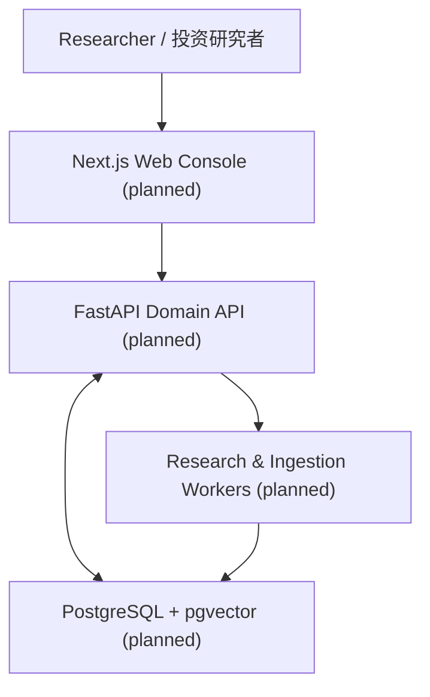
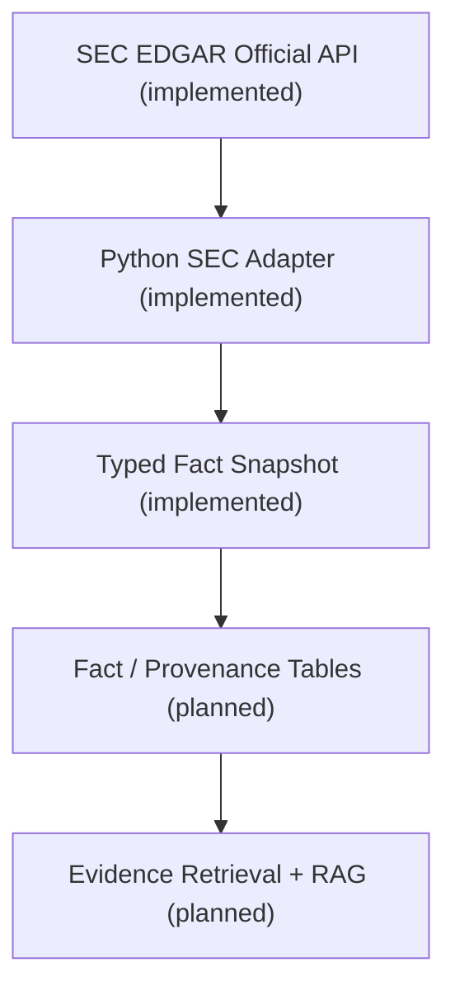
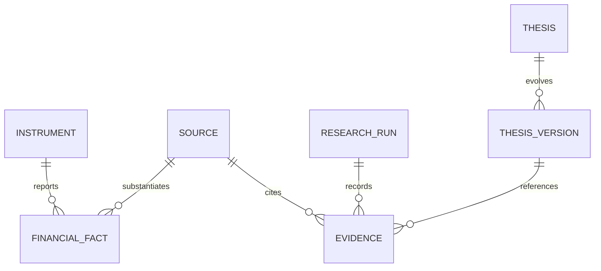
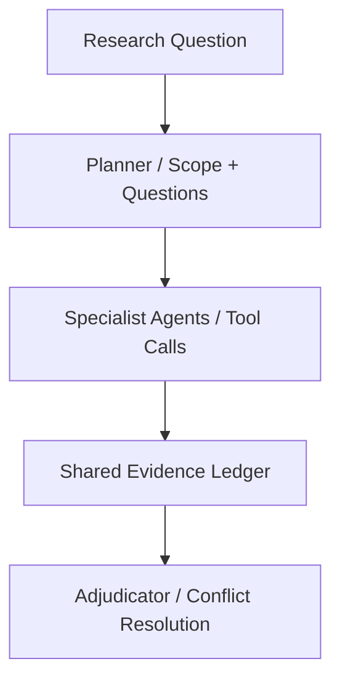

# Architecture / 技术架构

> **Current vs planned**：图中的完整 Web/AI 架构是设计目标。当前仓库实际交付：Python SEC Client、Company Facts 归一化快照、截止日过滤及离线单元测试。

## 1. System Context

## 2. Data-to-Evidence Pipeline

### P0 实际数据流

1. 从 `https://www.sec.gov/files/company_tickers.json` 解析 ticker → CIK。
2. 从 `https://data.sec.gov/api/xbrl/companyfacts/CIK{cik:010d}.json` 获取真实 US-GAAP Company Facts。
3. 选择已申报的 `10-K` / `10-Q` 观测值；支持按申报日期截止过滤。
4. 保留 `start`、`end`、`filed`、`form`、`accn`、`unit`、`concept`。
5. 将指标输出到本地 JSON，后续可用相同 Schema 导入 PostgreSQL。

**限制**：SEC XBRL 中部分季度记录是累计数，本阶段只保留原始期间，不进行未经验证的季度拆分；不能跨公司直接假定所有 GAAP 标签含义完全一致。

## 3. Planned Domain Modules

| Domain | Responsibility | Planned Interfaces |
| --- | --- | --- |
| Market Data | Licensed price adapters, time zones, corporate actions | `GET /instruments/{id}/prices` |
| Company Fundamentals | SEC facts, normalization, compare | `GET /companies/{id}/metrics` |
| Document Intelligence | Filing parsing, full-text search, source excerpts | `POST /research/retrieve` |
| Research Orchestrator | Task planning, source-based Agent collaboration | `POST /research/runs` |
| Evidence Ledger | Claim-to-source linking, citations, audit trail | `GET /research/runs/{id}/evidence` |
| Thesis Tracker | Versioning, hypotheses, invalidation conditions | `GET /theses/{id}/versions` |

## 4. Minimal Database Entities (P1)

关键字段：

- `financial_fact`: `instrument_id`, `taxonomy`, `concept`, `unit`, `value`, `period_start`, `period_end`, `filed_at`, `accession`, `retrieved_at`, `source_id`
- `source`: `provider`, `original_url`, `published_at`, `retrieved_at`, `license_scope`
- `evidence`: `run_id`, `claim_id`, `source_id`, `locator`, `supports_or_refutes`, `verification_status`
- `thesis_version`: `thesis_id`, `version`, `hypothesis`, `drivers`, `invalidation_conditions`, `created_at`

## 5. AI Research Orchestration (P2)

研究仲裁器输出**主判断、支持证据、反对证据、未决变量、可证伪条件**，详见 [research-adjudication.md](research-adjudication.md)。

## 6. Operational / Security Principles

- 前端不会直接持有 SEC 联系方式或付费行情 API Key；生产服务端统一调用 Provider。
- 所有外部数据都记录来源、获取时间和披露时间。
- 无权访问的行情数据不得通过抓取或伪装数据填补。
- AI 不得绕过查询层直接写入不可审计的财务事实。
- 长任务支持超时、重试、取消、成本上限和任务状态追踪。
- 用户授权前不执行下单、发送邮件或推送外部消息。
